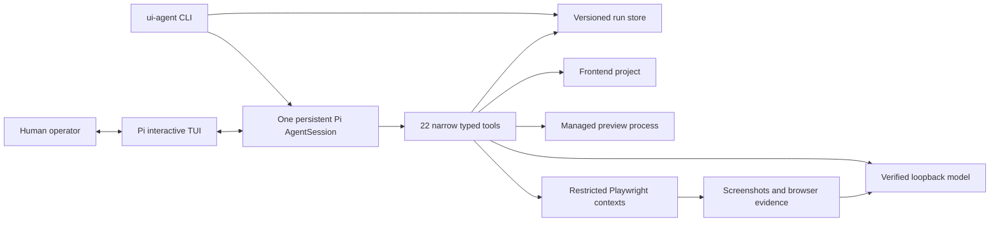
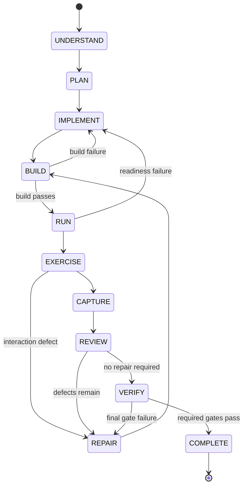

# Local UI Agent: Project in Depth

## 1. What this project is

Local UI Agent is a reusable, local-first coding-agent harness specialized in frontend work. It is not a demonstration website and it is not a wrapper that merely sends one prompt to a model. The product is the agent runtime itself: a CLI, a persistent Pi session, typed tools, approval workflows, browser automation, visual evidence collection, repair orchestration, configuration, tests, fixtures, and security boundaries.

The agent supports five main jobs:

1. Create a new frontend from a written brief.
2. Improve an existing frontend without silently replacing its stack or user work.
3. Recreate or restyle a project from user-owned screenshots.
4. Analyze an authorized public URL and transfer its visual system using replacement content and assets.
5. Audit an existing UI across multiple viewports, exercise interactions, record defects, and repair them within a bounded budget.

The implementation is frontend-only. It may generate mock data, typed service adapters, and documented API contracts, but it does not create production authentication, payments, databases, or backend services.

## 2. Current validation status

The deterministic implementation and browser vertical slice are working:

- TypeScript type checking, ESLint, and production compilation pass.
- Fourteen deterministic test files containing 31 tests pass.
- A real end-to-end scaffold test creates a React application, installs locked dependencies with lifecycle scripts disabled, builds it, runs its generated Playwright test, starts a production preview, exercises it in Chromium, audits desktop and mobile layouts, captures screenshots, and cleans up its process tree.
- Browser/runtime portions of the capability doctor pass.

The local model server was online during initial discovery but stopped listening before the completed capability matrix was run. The harness now has a local-first Groq fallback, but a real Groq capability matrix still requires a valid workspace `GROQ_API_KEY`. Therefore Pi tool continuation, genuine image understanding, two-image comparison, and the full model-driven repair demonstrations remain blocked rather than claimed as successful. The authoritative status is maintained in [`docs/validation-report.md`](docs/validation-report.md).

## 3. System architecture

The system uses one primary Pi agent session for each run. Analyst, designer, implementer, browser tester, visual reviewer, and repair planner are scoped prompt roles inside that session. They are not separate uncontrolled model processes.

The CLI is a control plane. Pi owns the conversation, message history, model streaming, tool calls, tool results, cancellation, compaction hooks, and session persistence. The run manifest owns durable product state such as decisions, approvals, defects, checkpoints, and evidence paths.

### Why one session

A single session keeps the approved brief, implementation reasoning, browser evidence, and repair history coherent. The trade-off is that the session must be compacted carefully. The `session_before_compact` hook therefore preserves an authoritative structured summary rather than retaining large logs and image payloads in conversation history.

### Why OpenAI compatibility

The installed Pi version exposes a documented custom provider path compatible with OpenAI chat/completions semantics. The same bounded adapter supports the loopback endpoint and Groq's OpenAI-compatible API. In `auto` mode, local discovery is attempted first; when it is unavailable and `GROQ_API_KEY` exists, the runtime registers a `groq` provider against the pinned official HTTPS base.

`ollama-native` exists in the configuration schema as a reserved protocol value, but the current Pi session refuses it because the installed SDK does not expose a documented native Ollama agent provider. Remote fallback is explicit through `model.provider=auto|groq`, uses an environment-only key, and is recorded in doctor/run provenance.

## 4. Model discovery and capability proof

The agent never trusts a model name or an advertised capability by itself.

The local discovery sequence is:

1. Call the configured `/api/tags` endpoint.
2. Record exact installed IDs and metadata.
3. Call `/v1/models` and verify the inference provider.
4. Select only an ID actually returned by discovery.
5. Prefer `qwen3.8:27b` only when that exact ID exists.
6. Test plain text generation.
7. Test structured JSON and bounded malformed-output recovery.
8. Test a direct tool call and tool-result continuation.
9. Test the same kind of safe file/tool round trip through a real Pi session.

If local discovery or `/v1/models` fails in `auto` mode, the agent loads the optional workspace `.env`, requires `GROQ_API_KEY`, queries the pinned Groq `/models` endpoint, verifies the configured exact Groq IDs, and then runs the same capability probes. A key is never written into configuration, run manifests, doctor reports, or preview-process environments.
10. Test genuine single-image understanding using a generated image with known text, colors, shapes, and positions.
11. Test genuine two-image comparison.
12. Test Node, npm, port allocation, Chromium launch, and screenshot output independently.

The doctor writes `PASS`, `FAIL`, or `NOT CONFIGURED` for each check. A model accepting an image field is not enough: it must answer the image questions correctly. A workflow will only trust a recent doctor report for the same endpoint and exact model ID.

All model endpoints are restricted to loopback hosts. There is no hosted fallback and no paid API integration.

## 5. Workflow state machine

Every run follows a bounded state machine:

The configured limits include repair rounds, elapsed time, tool timeout, model timeout, screenshot count and dimensions, image attachment count and bytes, and stagnant rounds without measurable improvement.

Terminal run statuses are:

- `ready_for_review`: required gates pass and no blocker/high defect remains.
- `needs_work`: the budget ended or lower-priority defects remain.
- `blocked`: a required capability, approval, or external condition is unavailable.
- `failed`: an unrecovered execution failure occurred.
- `cancelled`: the operator or abort signal cancelled the run.

Deterministic failures always outrank a favorable visual-model opinion.

## 6. Human collaboration model

The default interaction mode is `high`.

### High

The agent pauses at every material product or design decision. It groups focused questions, presents meaningful design directions, asks for explicit brief/direction approval, confirms external image adoption, and escalates when a repair budget ends with severe defects.

### Balanced

The agent confirms the brief and visual direction, then asks only when uncertainty could materially change the result.

### Autonomous

The agent proceeds within the approved brief but still stops for destructive, externally visible, legally sensitive, or genuinely ambiguous decisions.

Pi's real TUI facilities provide selection, confirmation, text input, editor review, notifications, widgets, and custom decision views. When no interactive terminal is available, the system stores grouped questions in the run manifest and changes the run to `pending_input`; it never invents the user's answer.

Material decisions are versioned. Revising a prior decision supersedes it and records the affected scope rather than leaving contradictory instructions active.

## 7. The 22 Pi tools

The inline Pi extension registers these tools:

| Tool | Responsibility |
| --- | --- |
| `inspect_project` | Detect framework, scripts, routes, dependencies, styling, assets, and Git state. |
| `read_relevant_files` | Read a bounded set of project-scoped, non-secret text files. |
| `scaffold_frontend` | Create the pinned React/Vite/Tailwind/Motion/Playwright baseline. |
| `apply_ui_patch` | Create, replace, or exactly edit files with path and hash protection. |
| `manage_preview` | Create a lockfile, install, build, run scripts, start/stop preview, and retrieve logs. |
| `browser_inspect` | Open/inspect preview or separately restricted reference pages. |
| `browser_interact` | Click, type, hover, focus, press keys, scroll, and select safely. |
| `capture_screenshot` | Capture stable-comparison or live-motion evidence. |
| `analyze_reference` | Send normalized real image bytes to the verified visual model. |
| `compare_screenshots` | Combine pixel localization with structured two-image review. |
| `run_quality_checks` | Run configured scripts, browser checks, axe, and Lighthouse budgets. |
| `checkpoint_project` | Create or conflict-safely restore agent-owned checkpoints. |
| `list_assets` | Inventory safe image and font assets. |
| `search_images` | Search implemented licensed-media providers without selecting assets. |
| `create_asset_contact_sheet` | Build a numbered local preview sheet for human selection. |
| `download_approved_image` | Download only the exact approved candidate and write provenance. |
| `register_supplied_asset` | Validate and record a user-supplied raster without inventing a license. |
| `record_design_spec` | Persist requirements, assumptions, design system, and acceptance criteria. |
| `record_defects` | Store or resolve evidence-backed defects. |
| `advance_workflow` | Enforce valid stage changes, counters, budgets, and terminal outcomes. |
| `ask_human` | Ask a small group of focused Pi-native questions and record answers. |
| `approve_direction` | Present an editable brief and persist explicit approval. |

Every tool has a narrow TypeBox schema, structured output, cancellation support, bounded artifacts/logs, and project/run-root enforcement.

## 8. Safe file editing and checkpoints

The model has no general-purpose shell tool. File access follows these rules:

- Canonical paths must remain inside the project root.
- Traversal and symlink escape are rejected.
- `.git`, environment files, credentials, SSH material, npm tokens, Pi auth, and other secret paths are blocked.
- Binary content cannot be read through the text tool.
- Existing files must be edited using the SHA-256 returned when they were read.
- Exact edit anchors must occur once.
- A patch validates all operations before writing any of them.
- Existing projects require an inspection, baseline quality report, and agent-owned checkpoint before broad edits.
- Checkpoint restore refuses to overwrite changes not recognized as agent-owned.

This preserves dirty working trees and concurrent user edits without using destructive Git reset operations.

## 9. Preview and browser lifecycle

Preview management detects the package manager from the lockfile and requires locked installation. Dependency lifecycle scripts are disabled during agent-managed installation.

Child processes receive:

- A project-scoped working directory.
- A scrubbed environment without model credentials, home-directory variables, SSH agents, cloud/cluster credentials, or container sockets.
- Bounded standard output and standard error.
- Readiness and execution deadlines.
- Process-tree cleanup on failure, cancellation, and Pi session shutdown.

The preview binds to `127.0.0.1` with a dynamically allocated strict port. When a built `dist` directory and preview script are available, production preview is preferred for deterministic browser validation.

### Preview browser

The preview context allows only the local application plus inline diagnostic URLs. It records page exceptions, console errors, broken images, failed or unexpected requests, empty roots, overflow, clipping, off-viewport controls, overlaps, focus behavior, axe findings, and interaction evidence.

### Reference browser

The reference context is separate and more restrictive. It blocks:

- Private, reserved, local, or internal destinations.
- Credentials embedded in URLs.
- Nonstandard ports.
- State-changing methods.
- Popups, downloads, permissions, and service workers.
- Password/file inputs and destructive-looking controls.
- Enter-based form submission.
- Unexpected cross-origin top-level navigation.

Visible webpage text and DOM content are treated as untrusted task data, not instructions to the agent.

## 10. Visual review and repair

Screenshots are captured only after readiness, fonts, and local images stabilize. Stable comparison and live motion are separate modes:

- Stable mode controls transient animation state for reproducible comparison.
- Live mode lets animation run and exercises scroll, hover, menus, and representative states.

Pixel metrics are used to locate changed regions; they are never presented as a fabricated accuracy percentage. The visual model produces structured findings about geometry, spacing, typography, color, imagery, hierarchy, responsive behavior, and motion. Each defect stores severity, page, viewport, state, evidence paths, observation, likely source, proposed repair, and verification method.

After a visual edit, rendering is mandatory. The smallest affected checks run first, followed by the required final gates.

## 11. Quality gates

Configured quality checks can include:

- TypeScript.
- Lint.
- Production build.
- Project Playwright tests.
- Uncaught exceptions and relevant console errors.
- Failed assets and unexpected network traffic.
- Empty React root or missing critical content.
- Horizontal overflow, clipping, overlap, and off-viewport controls.
- Keyboard focus visibility and likely traps.
- axe-core accessibility results.
- Broken routes and required flows.
- Lighthouse performance and accessibility budgets.

The default axe failure impacts are `serious` and `critical`. Default Lighthouse thresholds are 0.75 performance and 0.90 accessibility.

## 12. Image search and provenance

Openverse is the currently implemented search adapter. The workflow is deliberately approval-driven:

1. Derive subject, mood, placement, aspect ratio, colors, resolution, and accessibility purpose.
2. Approve proposed queries in high mode.
3. Search with timeouts, caching, rate limiting, and safe-search settings.
4. Filter unknown/incompatible licenses, watermarks, low resolution, and disallowed hosts.
5. Display metadata and a numbered contact sheet.
6. Record the exact selected candidate.
7. Obtain explicit download approval.
8. Follow only public, permitted HTTPS redirects.
9. Stream within the configured byte limit.
10. Validate MIME type, magic bytes, decoded dimensions, and pixel count.
11. Generate optimized WebP and responsive WebP/AVIF derivatives without upscaling.
12. Append creator, source, license, attribution, checksum, transformations, usage, and local paths to `assets.provenance.json`.

User-supplied assets use a separate validation path and are marked as user-authorized instead of receiving invented license metadata.

## 13. Persistent run artifacts

Each run lives under `.ui-agent/runs/<run-id>/`. The manifest is the durable source of truth and records:

- Immutable original brief, references, and URL.
- Safe model/provider configuration.
- Normalized requirements and design specification.
- Interaction mode, questions, approvals, and revised decisions.
- Current stage and terminal status.
- Plan, source-change summaries, and checkpoints.
- Preview, build, test, and browser evidence.
- Screenshots, diffs, and visual-review JSON.
- Defects and their verification state.
- Image queries, candidates, selection, license, checksum, and provenance.
- Durations, retries, counters, and stop reason.

Large images, dependency trees, and repetitive logs stay in artifact files instead of being copied into every model turn.

## 14. Repository map

| Path | Purpose |
| --- | --- |
| `src/cli.ts` | Commander CLI and command arguments. |
| `src/config/` | Versioned Zod configuration and persistence. |
| `src/model/` | Local/Groq selection, inference, structured recovery, and doctor evidence. |
| `src/pi/` | Pi provider/session construction, tools, TUI views, and compaction. |
| `src/state/` | Run manifest, approval policy, persistence, and workflow transitions. |
| `src/tools/` | Safe filesystem, preview, browser, quality, visual, asset, and checkpoint implementations. |
| `src/templates/` | Pinned frontend scaffold. |
| `src/workflows/` | Start/resume orchestration and role prompts. |
| `prompts/` | Analyst, designer, implementer, visual-reviewer, and repair roles. |
| `tests/unit/` | Deterministic behavior and boundary tests. |
| `tests/integration/` | Real browser evidence collection. |
| `tests/e2e/` | Generated-project and conditional live workflow demonstrations. |
| `tests/live/` | Explicit local-model capability validation. |
| `fixtures/` | Briefs, owned screenshots, and deliberate defect project. |
| `docs/` | Architecture, configuration, security, troubleshooting, versions, and validation evidence. |

## 15. Security boundary and honest limitations

The agent provides strong project scoping and a scrubbed process boundary, not a complete sandbox. This Windows host has no Docker or Podman. Malicious dependencies or generated code could still exploit the host process environment or operating system.

For hostile or multi-tenant workloads, run the entire agent inside a dedicated VM or hardened container, expose only the target project and artifact directory, remove host credentials, deny unnecessary outbound traffic, and keep inference loopback-only inside that boundary.

Other current limitations are:

- Live model/Pi/vision acceptance must be rerun after the endpoint returns.
- Openverse is the only completed live image-search client.
- Conservative URL safeguards can block complex authorized sites.
- Lighthouse varies across machines and should use repeated median measurements for release enforcement.
- The neutral scaffold intentionally excludes GSAP and Three.js until an approved design brief requires them.

For installation and daily usage, continue with [`AGENT_OPERATIONS_GUIDE.md`](AGENT_OPERATIONS_GUIDE.md).
