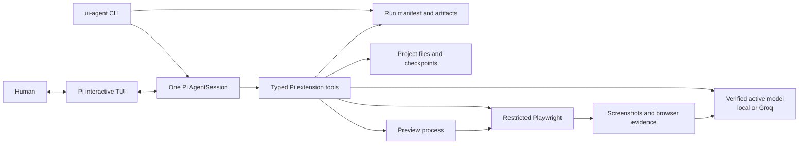
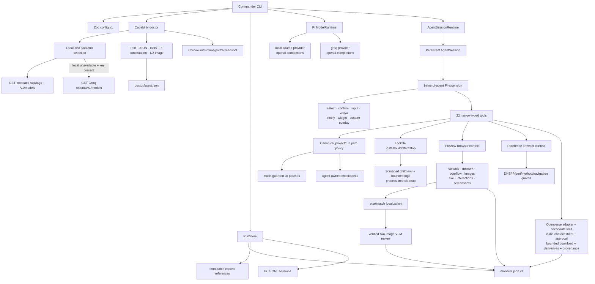
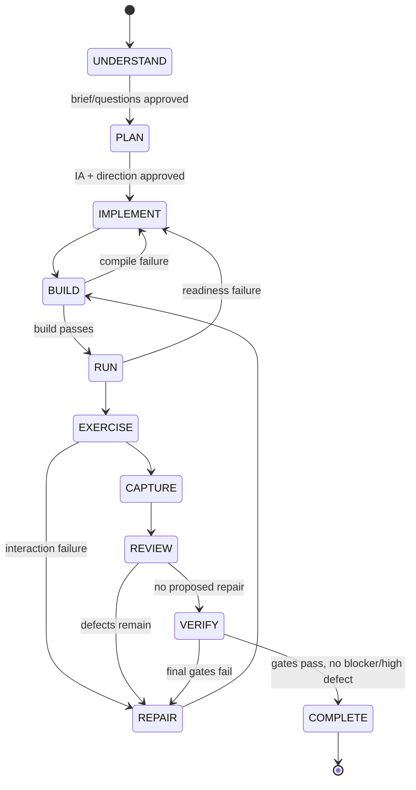

# Architecture

## Chosen shape

The harness uses one persistent Pi agent session per run. “Analyst,” “designer,” “implementer,” “browser tester,” “visual reviewer,” and “repair planner” are prompt-scoped roles inside that session, not uncontrolled child agents. Pi owns messages, tool calls, streaming events, cancellation, session JSONL, retry, and compaction. A separate versioned run manifest holds durable product decisions and test evidence so compaction never needs to retain huge logs or images.

The CLI is intentionally a control plane, not a second agent loop.

## Detailed flow

## Workflow state machine

Terminal statuses are `ready_for_review`, `needs_work`, `blocked`, `failed`, and `cancelled`. Budgets cover elapsed time, repair rounds, tool/model timeouts, attachment sizes/counts, and stagnant rounds.

## Pi integration details

- `ModelRuntime.registerProvider()` registers the selected `openai-completions` provider after exact model discovery. `auto` prefers loopback inference; if that probe fails and `GROQ_API_KEY` is available, it uses the pinned official Groq endpoint.
- `createAgentSessionServices()` and `createAgentSessionFromServices()` construct cwd-bound services and the persistent session.
- `createAgentSessionRuntime()` supports session replacement/resume, while `InteractiveMode` supplies Pi's real TUI.
- An inline extension registers every project/browser/human tool and commands such as `/ui-status`, `/ui-direction`, `/ui-brief`, and `/ui-decisions`.
- `session_before_compact` stores an authoritative compact summary containing the current design specification, decisions, approvals, unresolved defects, source changes, checkpoints, and evidence paths.
- `session_shutdown` closes preview process trees and browser contexts.

## Tool boundary

Tools use TypeBox parameter schemas and return structured details plus bounded human-readable content. Canonical paths are enforced against the project/run roots, with secret-file and binary-read blocks. Model code never receives a general shell. Preview scripts are limited to named package scripts and dependency installation requires a lockfile; the scaffold can create a lockfile with scripts disabled.

## Trade-offs

- A single session makes decisions and evidence coherent and resumable, at the cost of requiring disciplined compaction.
- OpenAI compatibility provides one bounded client path for both local inference and Groq; provider, endpoint, and model ID are bound into doctor evidence before a workflow can start.
- Pixel metrics locate changes but never become a fabricated “accuracy score.” Visual judgment stays structured and cannot override deterministic gates.
- Local-process isolation works on this Windows host without Docker, but it is not safe for hostile untrusted code. See [security.md](security.md).
